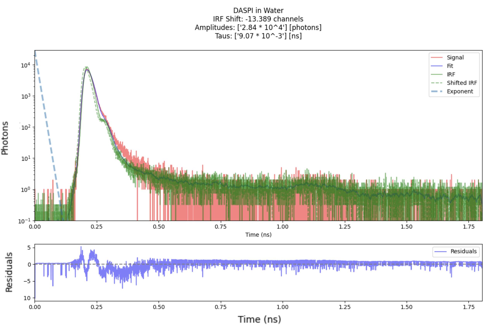

# ReconFit

[](./LICENSE)
[](#installation)

Reconvolution fitting of time-correlated single-photon counting (TCSPC) fluorescence decays in
Python. ReconFit fits a sum of exponentials convolved with a measured instrument response function
(IRF), with a sub-channel IRF shift and a constant background, and plots the fit with its residuals.

It is meant for analysing **freely and publicly available, non-personal TCSPC decay data** and
**synthetic examples**. It is a small, script-style tool for fitting single decay histograms. It
is not a validated package and is not intended for clinical or diagnostic use.

**Who it is for:** students and researchers who want a short, readable reconvolution workflow
(NumPy, SciPy, pandas and Matplotlib) that they can inspect and adapt.

## What it does

- **Reads** ASCII `.asc` decay exports (`Time[ns]`, photon counts), either one file or a numbered series.
- **Fits** `y(t) = Σₖ aₖ · [IRF(t − Δ) ⊗ e^(−t/τₖ)] + c` with `aₖ, c ≥ 0`:
  - SciPy differential evolution searches the lifetimes `τₖ` and the IRF shift `Δ` (in channels) within bounds you set.
  - For each candidate, non-negative least squares (NNLS) solves the amplitudes `aₖ` and the offset `c`.
- **Convolves** with FFTs and shifts the IRF by fractional channels using linear interpolation.
- **Plots** the data, fit, IRF, shifted IRF and component curves on a log scale, with weighted residuals underneath.
- **Summarises a series** of decays (peak counts, FWHM or integral per file) as bar charts. Each decay first has its minimum subtracted and is Savitzky–Golay smoothed, and flagged bins can be replaced with values from their neighbours.



*Example fit plot (`figures/DASPI.png`), included to show the layout, not as a reference result.
The current `plot_reconvolution` also adds χ²_ν and a sum-of-exponentials curve.*

## Installation

The repository has no package metadata, so you run it from a local checkout. `TCSPC_Reconvolution.py`
imports `numpy`, `pandas`, `matplotlib` and `scipy`:

```bash
git clone https://github.com/mkizilov/ReconFit.git
cd ReconFit
python3 -m venv .venv                 # use Python 3.10, 3.11 or 3.12
source .venv/bin/activate             # Windows: .venv\Scripts\activate
python -m pip install --upgrade pip
python -m pip install "numpy<2" scipy "pandas<3" "matplotlib<3.8"
python -m pip install notebook        # optional, only needed for example.ipynb
```

The upper version bounds are needed because the code uses APIs that newer releases changed or removed:

| Package | Breaks at | What fails |
| --- | --- | --- |
| NumPy | 2.4 | `np.trapz`, used by `plot_histogram(..., 'integral')` |
| pandas | 3.0 | `fillna(method=...)`, used by smoothing in `prepare_data` |
| pandas | 3.0 | Read-only arrays crash fit plotting |
| Matplotlib | 3.8 | Colorbar handling in `plot_FLIM_spectrum` for a list of decays |
| Matplotlib | 3.9 | `cm.get_cmap` was removed (also used by `plot_FLIM_spectrum`) |

Matplotlib 3.7 needs NumPy 1.x and has no wheels for Python 3.13 or newer, which is why the Python
range stops at 3.12.

## Quickstart (synthetic data, no files needed)

Run this from the repository root. It builds a noisy bi-exponential decay from a Gaussian IRF and
fits it in a few seconds:

```python
import numpy as np
import pandas as pd
from TCSPC_Reconvolution import reconvolution_fit

rng = np.random.default_rng(0)
t = np.arange(512) * 0.02                       # 512 channels, 20 ps each (ns)

irf = np.exp(-0.5 * ((t - 1.0) / 0.05) ** 2)    # Gaussian IRF at 1 ns, sigma 50 ps
irf /= irf.sum()
irf_meas = rng.poisson(2e5 * irf + 1.0)        # "measured" IRF with 1 count background
decay = 3000 * np.exp(-t / 0.4) + 1000 * np.exp(-t / 2.5)   # true taus: 0.4 and 2.5 ns
signal = rng.poisson(np.convolve(irf, decay)[: t.size] + 2.0)  # + 2 counts background

df_signal = pd.DataFrame({"Time": t, "Photons": signal.astype(float)})
df_irf = pd.DataFrame({"Time": t, "Photons": irf_meas.astype(float)})

np.random.seed(0)   # reconvolution_fit has no seed argument; this makes the search repeatable
taus, amps, irf_shift, offset, chi2 = reconvolution_fit(
    [df_signal, df_irf],
    exp_num=2,
    tau_bounds=[(0.05, 1.0), (1.0, 6.0)],   # ns, one (low, high) pair per component
    irf_shift_bounds=[-20, 20],             # channels, not ns
    maxiter=200,
)

print("taus (ns):      ", np.round(taus, 3))
print("amplitudes:     ", np.round(amps, 1))
print("IRF shift (ch): ", round(irf_shift, 2))
print("offset (counts):", round(offset, 2))
print("chi2 / N:       ", round(chi2, 3))
```

Expected output:

```text
taus (ns):       [0.397 2.475]
amplitudes:      [2993.4 1013.2]
IRF shift (ch):  0.03
offset (counts): 1.93
chi2 / N:        0.984
```

To get the diagnostic figure, add `plot_title="Synthetic bi-exponential"`. Adding `filename="name"`
as well saves the figure to `plots/name.png`, but you have to create the `plots/` directory first.

## Working with `.asc` files

```python
import numpy as np
from TCSPC_Reconvolution import parse_FLIM, parse_FLIM_set, reconvolution_fit, plot_FLIM_spectrum, plot_histogram

decay = parse_FLIM("path/to/decay.asc")   # DataFrame with columns Time (ns) and Photons
irf = parse_FLIM("path/to/irf.asc")       # same channel width as the decay

np.random.seed(0)
taus, amps, irf_shift, offset, chi2 = reconvolution_fit(
    [decay, irf], exp_num=2, tau_bounds=[(0.01, 1.0), (1.0, 10.0)],
    irf_shift_bounds=[-50, 50], plot_title="Decay vs. IRF")

series = parse_FLIM_set("path/to/folder", file_startswith="sample_c")  # sample_c1.asc, sample_c2.asc, ...
plot_FLIM_spectrum([d.copy() for d in series], min_scale=1, title="All cycles")
plot_histogram([d.copy() for d in series], what_to_plot="fwhm", bad_bins=None, plot_name="FWHM per cycle")
```

`example.ipynb` goes through the same steps with the files in `data/example/`.

### Expected file format

`parse_FLIM` looks for this exact header line, with two spaces between the fields, and reads the
two-column block that follows it:

```text
...instrument/header metadata (ignored)...
*BLOCK 1  ( Time[ns]  No_of_photons )
0.000000      0
0.000509      0
...
*END
```

- Each row is a time in ns and a count, separated by **spaces**. Tab-separated rows fail to parse.
- The first row after the header becomes the pandas column header, so that channel is dropped.
- Rows that are not numeric, such as `*END`, are removed, and the rows are sorted by time.
- `parse_FLIM_set` loads every `.asc` file in the directory whose name starts with `file_startswith`.
  It orders them by the number in a trailing `c<N>.asc`. Files without that pattern go last.
- `.sdt` files are **not** read.

## Main functions

| Function | Purpose |
| --- | --- |
| `reconvolution_fit(FLIM_data, exp_num=1, tau_bounds=None, irf_shift_bounds=[-500, 500], smooth=None, maxiter=1000, disp=False, workers=1, plot_title=None, filename=None)` | Fits `[signal_df, irf_df]`. Returns `(taus, amplitudes, irf_shift, offset, chi2)`, with taus in ascending order. Default `tau_bounds` is `(1e-12, 2)` ns per component. |
| `prepare_data(df_signal, df_irf, window_length=None, polyorder=None)` | Called by the fit. Trims zero-count channels at both ends and restarts each time axis at 0. Truncates both curves to the same number of channels and scales the IRF so its counts sum to 1. |
| `parse_FLIM(filename)`, `parse_FLIM_set(directory, file_startswith)` | Read one `.asc` file or a sorted series into DataFrames with `Time` and `Photons` columns. |
| `plot_reconvolution(...)`, `plot_FLIM_spectrum(...)`, `plot_histogram(...)`, `apply_savgol(...)` | Fit diagnostics, log-scale decay overlays, per-file metrics and a Savitzky–Golay smoothing preview. |
| `convolve`, `shift_irf`, `nnls_convol_irfexp`, `residual_function` | Building blocks of the model, useful if you want to adapt it. |

## Fitting caveats

- **Statistic.** The fit minimises `Σ (fit − data)² / (fit + 1) / N`. This is model-weighted least squares, not a Poisson maximum-likelihood fit, so expect bias when counts are low. The returned `chi2` is divided by `N`, while the plot title divides by `N − K − 1`. Neither gives standard errors for `τ`.
- **Sampling.** The signal and IRF must use the same uniform channel width. Nothing is resampled; both are truncated by channel index.
- **IRF shift.** Each curve is trimmed and restarted at t = 0 separately, so any offset between them ends up in the fitted shift. The shift is in channels: multiply by the bin width to get ns.
- **Circular shift.** Counts shifted past one end wrap around to the other, so keep `irf_shift_bounds` narrow. The default ±500 channels is very wide.
- **Missing physics.** There is no correction for incomplete decay between excitation pulses, pile-up or dead time. There is no scatter term and no global or pixel-wise (image) fitting.
- **Identifiability.** Lifetimes that are close together, or comparable to the IRF width or the channel width, are poorly constrained. Results depend on bounds, `exp_num` and the random seed. Treat a `τ` that sits on a bound as a warning sign, check the residuals and compare models.
- **Smoothing.** `smooth=(w, p)` applies a centred moving average of `w` channels before fitting; `p` only switches it on. This changes the noise statistics and makes χ² hard to interpret.
- **Plot side effects.** `plot_FLIM_spectrum(single_df)` overwrites `Photons` with smoothed values in place, and `plot_histogram` adds helper columns to its inputs. Pass `df.copy()` if you want to keep the raw counts.
- **Component curves.** The fit plot draws each component as an unconvolved `aₖ·e^(−t/τₖ)` starting at t = 0.
- **Runtime.** A single DE fit over a few thousand channels can take tens of seconds or more. `workers` is passed to SciPy (`-1` uses all cores), but process overhead can make it slower for small problems. In scripts, put the call under `if __name__ == "__main__":`.

## Project layout

```text
ReconFit/
├── TCSPC_Reconvolution.py   # all parsing, fitting and plotting functions
├── example.ipynb            # walkthrough using data/example/
├── data/example/            # example .asc decays and IRF (plus .sdt files, not used by the code)
├── figures/DASPI.png        # example fit plot
└── LICENSE                  # MIT
```

## License

The software is released under the [MIT License](./LICENSE). Datasets you analyse or share with
it are covered by their own licences and terms, which are separate from the software licence.
